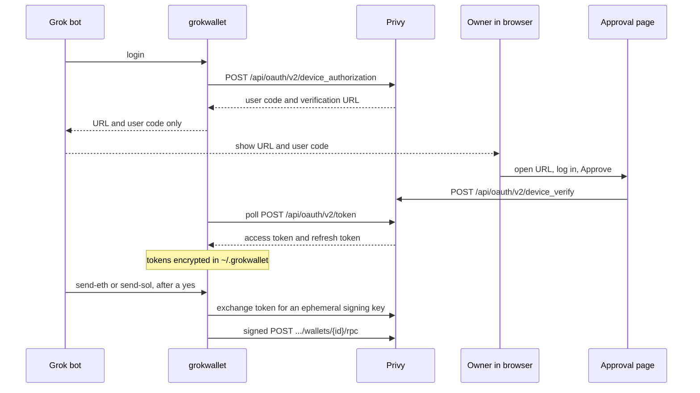

# GrokWallet

GrokWallet is a non-custodial Ethereum and Solana wallet for a [Grok Bot](https://grok.com) agent. The person who owns the wallets approves the agent once in a browser. After that, the agent can read balances, show receive addresses, send native ETH or SOL, and sign messages. The agent never receives a wallet private key, and it never receives a Privy app secret.

Wallets are created on the owner's Privy account when they log in on the approval page. The publisher of this template cannot sign for those wallets.

## Architecture



The approval page is a static Next.js export. The release workflow builds it once, attests that output, and deploys those files to Cloudflare Pages. The export includes a `_headers` file so Pages sends a Content Security Policy and `X-Frame-Options: DENY`. The same files are pinned to IPFS when a pinning token is configured, so anyone can compare the live site to the attested bytes. The CLI is a small Node program the bot runs on its own machine.

## Trust model

| Who | Can | Cannot |
| --- | --- | --- |
| Wallet owner | Approve or deny the agent, revoke a session, move funds from the Privy dashboard, set a CLI spend cap | Lose the wallets if the bot's disk is wiped. The wallets stay on the Privy account |
| Grok bot, after approval | Ask Privy to sign and send, within the CLI cap and any Privy policy on the wallet | See the wallet private key, the passphrase, or an app secret |
| Publisher of this repo | Host the approval page, set the public app id, create dashboard policies if they hold the app secret | Sign a user-owned wallet. Privy requires the owner's authorization signature for wallet RPC |
| Someone who only has this git repo | Read the public app id and rebuild the page | Move funds. There is no app secret in the repo |

The CLI cap is a local check. It stops this program from sending more than the owner allowed. It is not enforced inside Privy. A [Privy policy](https://docs.privy.io/controls/policies/overview) is enforced in Privy's enclave, and creating one uses the app secret, so the bot cannot install it. See [docs/PRIVY.md](docs/PRIVY.md).

Treat the machine that holds `~/.grokwallet` as able to spend, up to the cap and any policy, until the owner revokes the session or the refresh token expires (30 days, rotated on use).

## Quickstart for someone using the bot

1. Import [`template/grokwallet.json`](template/grokwallet.json) as a Grok Bot. The publisher replaces `REPLACE_WITH_PRIVY_APP_ID` and confirms the approval page URL before distributing the template.
2. When the bot asks, save a long passphrase as a masked secret named `GROKWALLET_PASSPHRASE`. Do not paste it into the chat.
3. Open the approval link the bot shows. Check that the code matches. Log in with Privy and press Approve.
4. Fund the addresses the bot shows. Incoming transfers do not need the agent.
5. The bot must show a summary and wait for an explicit yes before it sends or signs, unless you have set a standing rule inside the cap.

The pinned install is release `v0.1.0`, checked with `SHA256SUMS`. Until that tag exists, the bot is supposed to stop and say so.

## Quickstart for someone running the CLI

```sh
export GROKWALLET_APP_ID="your-25-character-public-app-id"
export GROKWALLET_PASSPHRASE="the masked secret"
node bot/bin/grokwallet.js login
node bot/bin/grokwallet.js addresses
node bot/bin/grokwallet.js balance
node bot/bin/grokwallet.js cap set --eth 0.01 --sol 0.05
```

`login` writes only the verification URL and the user code to stdout. Tokens are encrypted at rest. `send-eth`, `send-sol`, and `sign-message` refuse to run without `--yes`.

## Quickstart for the repo owner

The owner hosts the approval page and the Privy app. Wallet owners do not do this.

1. Create a Privy app, enable **CLI and agent access**, and copy the 25-character public app id into the `PRIVY_APP_ID` Actions variable.
2. Create a Cloudflare Pages project named `grokwallet` (direct upload, production branch `main`) and store `CLOUDFLARE_API_TOKEN` and `CLOUDFLARE_ACCOUNT_ID` as Actions secrets.
3. Attach the apex domain `grokwallet.fun` (the zone has to be on Cloudflare DNS) and set the Privy verification URI to `https://grokwallet.fun/`.
4. Tag `v0.1.0`. The workflow builds the page once, attests it, and uploads that tree to Pages. Add `IPFS_PINNING_TOKEN` only if you also want the IPFS copy.
5. Replace `REPLACE_WITH_PRIVY_APP_ID` in the template, then share `template/grokwallet.json`. The approval page in the template is `https://grokwallet.fun/`.

Details, DNS, and rotation: [docs/HOSTING.md](docs/HOSTING.md). Checking the live files against the attestation: [docs/VERIFY.md](docs/VERIFY.md).

Node `22.23.3` is pinned in [`.nvmrc`](.nvmrc). From a release tarball:

```sh
sha256sum -c SHA256SUMS
tar -xzf grokwallet-bot.tar.gz
cd grokwallet-bot
npm ci --omit=dev
```

## Repository layout

| Path | What it is |
| --- | --- |
| [`app/`](app/) | Static approval page. Public app id only |
| [`bot/`](bot/) | `grokwallet` CLI |
| [`template/grokwallet.json`](template/grokwallet.json) | Grok Bot template |
| [`docs/HOSTING.md`](docs/HOSTING.md) | What the repo owner configures |
| [`docs/VERIFY.md`](docs/VERIFY.md) | Rebuild a commit, check Pages and IPFS against the attestation |
| [`docs/PRIVY.md`](docs/PRIVY.md) | Privy calls this repo makes, with doc URLs |
| [`.github/workflows/`](.github/workflows/) | CI, provenance attestation, Cloudflare Pages deploy, optional IPFS pin, GitHub release |

## Links

- Privy agent authorization: https://docs.privy.io/recipes/agent-integrations/agent-authorization
- Privy authorization signatures: https://docs.privy.io/api-reference/authorization-signatures
- Privy Agent CLI, and why this repo does not shell out to it: https://docs.privy.io/recipes/agent-integrations/agent-cli
- Security reports: [SECURITY.md](SECURITY.md)
- License: [MIT](LICENSE)
